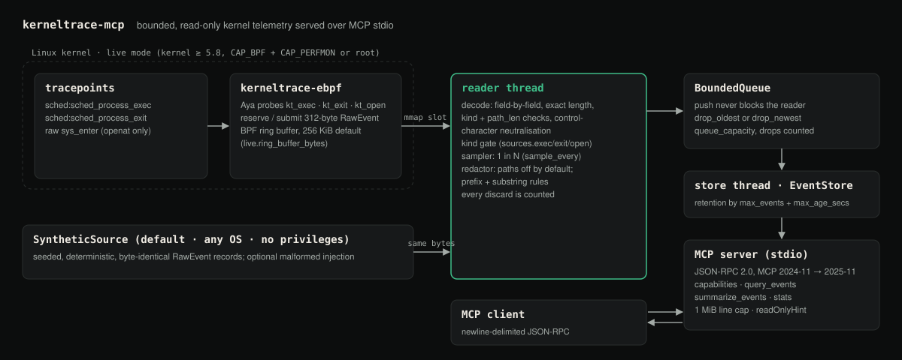
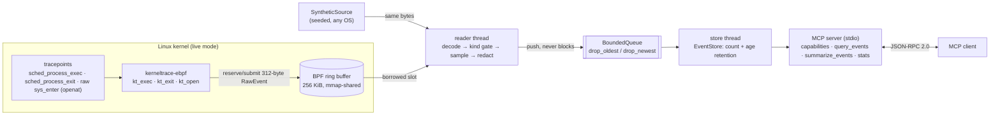

# eBPF-KernelTrace-MCP


[](https://m8ven.ai/mcp/hellpuffyt-ebpf-kerneltrace-mcp-ydx35a?s=readme)

**Give an AI assistant read-only, permission-controlled access to Linux process and file activity, through the Model Context Protocol.**

[Case study ↗](https://hellpuff.dev/work/ebpf-kerneltrace-mcp)



<sub>Diagram of the real pipeline in `kerneltrace-ebpf`, `kerneltrace-core` (`decode`, `engine`, `queue`, `store`) and `kerneltrace-mcp`. Only the synthetic path runs without Linux and privileges.</sub>

`kerneltrace-mcp` collects a small, documented set of kernel events (process exec, process exit, `openat`). It filters, samples, redacts and retains them under hard limits, then serves them to any MCP client over stdio. A deterministic **synthetic mode** runs the whole pipeline on any OS without privileges, so you can try it, test it and build on it before you go near a kernel.

> **Status: experimental, 0.1.0. Not production-ready.** The userspace pipeline and MCP server are tested in CI on Linux, macOS and Windows. The live eBPF path passes an end-to-end integration test on two kernels (7.0.0-1017-azure/x86_64 and 6.8.0-117-generic/aarch64); see [docs/KERNEL_COMPAT.md](docs/KERNEL_COMPAT.md). Overhead under load has not been measured (see [Limitations](#limitations--roadmap)).

```console
$ kerneltrace-mcp --seed 7 --rate 1000 --open --include-paths --dump 4
{"seq":1,"ts_ns":1000000,"received_ns":6338875,"kind":"open","pid":1000,"tid":1000,"uid":0,"comm":"cron","path":"/proc/self/status","ret":524288}
{"seq":2,"ts_ns":2000000,"received_ns":6346333,"kind":"open","pid":1000,"tid":1000,"uid":0,"comm":"cron","path":"/tmp/build.lock","ret":0}
{"seq":3,"ts_ns":3000000,"received_ns":6346791,"kind":"exit","pid":1003,"tid":1003,"uid":1000,"comm":"systemd","ret":0}
{"seq":4,"ts_ns":4000000,"received_ns":6347791,"kind":"open","pid":1002,"tid":1002,"uid":1000,"comm":"nginx","path":"/etc/hosts","ret":524288}
```
(Synthetic events. `ret` holds the `openat` flags; 524288 = `O_CLOEXEC`. `received_ns` depends on timing; everything else is fixed by the seed.)

## Why

When you ask an assistant "what is this box doing?", it usually ends up running `ps`, `lsof` or `strace` through a shell tool. That means broad shell access, unbounded output and no redaction. kerneltrace takes a narrower approach:

- **Narrow interface.** Four read-only tools. There is no shell, no arbitrary BPF and no write path.
- **Bounded by construction.** Fixed-size queues, count and age retention, and a hard per-query cap. Every drop is counted and reported.
- **Private by default.** File paths are never collected unless the operator turns them on. When they are on, redaction rules still apply.
- **Testable without root.** The synthetic source produces byte-identical ring-buffer records, so the decoder, pipeline and server run the same code in CI as they would against the kernel.

**Who it's for:** SREs and developers who want an assistant to help triage process and file activity, and people building MCP servers who want a worked example of a bounded, read-only telemetry server.

**Alternatives.** [bpftrace](https://github.com/bpftrace/bpftrace), [BCC](https://github.com/iovisor/bcc) and [Tetragon](https://github.com/cilium/tetragon) are far more capable tracers. kerneltrace does not replace them. It is a deliberately small surface meant to be handed to an AI client. Unlike a raw tracer, it does not allow arbitrary probes.

## Quick start

Requires Rust ≥ 1.88.

```sh
git clone https://github.com/hellpuffyt/eBPF-KernelTrace-MCP && cd eBPF-KernelTrace-MCP
cargo build --release
./target/release/kerneltrace-mcp --capabilities     # what this host supports
./target/release/kerneltrace-mcp --dump 5            # print 5 synthetic events
cargo test                                           # full suite, no privileges
```

### Use it from an MCP client

The server speaks newline-delimited JSON-RPC 2.0 on stdio and negotiates MCP revisions `2025-11-25`, `2025-06-18`, `2025-03-26` and `2024-11-05`, shaping its responses for whichever revision was agreed. The newest published revision, `2026-07-28` (stateless, no `initialize`), is **not** supported yet. See [docs/ARCHITECTURE.md](docs/ARCHITECTURE.md#mcp-surface) for the per-revision differences. Most desktop MCP clients accept an `mcpServers` entry like this:

```json
{
  "mcpServers": {
    "kerneltrace": {
      "command": "/absolute/path/to/kerneltrace-mcp",
      "args": ["--rate", "200", "--open"]
    }
  }
}
```

The project has tested the server with its own stdio client (`crates/kerneltrace-mcp/tests/mcp_stdio.rs`). It has not yet been verified against a specific third-party client. Reports are welcome.

### A real session

Captured from `kerneltrace-mcp --seed 7 --rate 200 --open --include-paths`. Requests are shown as `→`; only `structuredContent` is shown, abbreviated. Counts depend on how long the server has been running.

```text
→ {"jsonrpc":"2.0","id":2,"method":"tools/call","params":{"name":"summarize_events","arguments":{"top_n":3}}}
{ "total": 230, "by_kind": {"exec": 32, "exit": 29, "open": 169},
  "top_comms": [{"key":"nginx","count":61}, {"key":"systemd","count":52}, {"key":"cargo","count":37}],
  "top_pids": [{"key":1013,"count":18}, {"key":1010,"count":15}, {"key":1002,"count":14}],
  "seq_range": [1, 230], "events_per_sec": 200.37 }

→ {"jsonrpc":"2.0","id":3,"method":"tools/call","params":{"name":"query_events","arguments":{"kinds":["open"],"limit":2}}}
{ "events": [
    {"seq":229,"kind":"open","pid":1030,"comm":"cargo","path":"/usr/lib/x86_64-linux-gnu/libc.so.6","ret":0, ...},
    {"seq":230,"kind":"open","pid":1031,"comm":"bash","path":"/etc/passwd","ret":0, ...} ],
  "returned": 2, "matched": 169, "truncated": true, "next_after_seq": 230 }

→ {"jsonrpc":"2.0","id":4,"method":"tools/call","params":{"name":"stats"}}
{ "source": "synthetic", "records": 230, "stored": 230, "redacted": 52, "decode_errors": 0,
  "queue_dropped_newest": 0, "queue_dropped_oldest": 0, "evicted_capacity": 0, "evicted_age": 0,
  "queue_latency": {"p50_us": 12.96, "p95_us": 39.25, "p99_us": 242.71, "max_us": 396.71, "samples": 230}, ... }
```

The synthetic stream includes paths such as `/home/alice/.ssh/id_ed25519` and `/srv/app/.env`. With the default rules these come out as `<redacted>` (or `/home/<redacted>`); the `redacted` counter (52 here) counts them.

### Tools

All four tools are read-only and return JSON. Unknown arguments are rejected.

| Tool | Arguments | Returns |
|---|---|---|
| `capabilities` | none | Whether live eBPF is possible on this host and, if not, every reason; which event kinds and sensitive fields are enabled. |
| `query_events` | filters (below), `limit` (1 to `max_query_limit`, default 50) | The most recent matching events in sequence order, or with `after_seq` the next page after that sequence number. Includes `matched`, `truncated` and `next_after_seq`. |
| `summarize_events` | filters, `top_n` (1–50, default 5) | Counts by kind, top command names and pids, event rate. |
| `stats` | none | Pipeline counters: records read, decode errors, sampled out, redacted, queue drops, evictions, queue latency percentiles. |

Filters: `pids` (array of integers), `comms` (exact command names), `kinds` (`exec`, `exit`, `open`), `path_prefix`, `after_seq`, `last_secs`. Each array holds at most 64 entries and each string at most 4096 bytes, which bounds the cost of a query.

Errors follow JSON-RPC: bad arguments get `-32602` with the field and the limit in the message (for example `limit must be between 1 and 500, got 999999`), an unknown tool name gets `-32602` listing the available tools, malformed JSON gets `-32700` without ending the session, and tool calls before `initialize` are refused.

## Features

**Implemented**
- Synthetic source: seeded, deterministic, emits byte-exact ring-buffer records; optional malformed-record injection.
- Safe decoder: field-by-field, no transmutes, exact-length check, kind and `path_len` validation, control-character neutralisation. Property-tested against arbitrary bytes.
- Bounded reader→store queue that never blocks the reader, with a `drop_oldest` or `drop_newest` policy. Both kinds of drop are counted.
- Per-kind enable flags, deterministic 1-in-N sampling, and retention by count and by age.
- Redaction: paths are off by default. When enabled, substring rules hide the whole path and directory-prefix rules hide everything below the prefix.
- Capability detection: OS, kernel ≥ 5.8, tracefs, CAP_BPF+CAP_PERFMON or CAP_SYS_ADMIN, plus BTF presence (informational). Every unmet requirement is given as a plain-English reason.
- MCP server over stdio: `initialize` with version negotiation, `ping`, `tools/list`, `tools/call`. Tools: `capabilities`, `query_events`, `summarize_events`, `stats`. All four are read-only. Each declares `readOnlyHint: true`, `destructiveHint: false`, `idempotentHint: true` and `openWorldHint: false` when the negotiated revision supports annotations (2025-03-26 and later); 2024-11-05 clients get the same tools without annotations, because that revision has no field for them.
- Protocol hardening: 1 MiB message cap, parse errors that don't kill the session, strict and bounded argument validation with field-level error messages, tools refused before `initialize`, and graceful shutdown on EOF, SIGINT/SIGTERM or EPIPE.
- TOML configuration with unknown-key rejection and range validation.

**Experimental (integration-tested on 7.0.0-1017-azure/x86_64 and 6.8.0-117-generic/aarch64 only)**
- `kerneltrace-ebpf`: Aya tracepoint programs `kt_exec`, `kt_exit` and `kt_open` writing to a BPF ring buffer (256 KiB by default; `[live] ring_buffer_bytes`). Path reads are gated by a loader-set global.
- `live` feature: loads the object, attaches only the enabled programs and drains the ring buffer.

**Planned** (no code yet): epoll wake-ups instead of 5 ms polling, CO-RE/BTF field access, more event kinds (connect, setuid), a Streamable HTTP transport.

## Architecture



The BPF ring buffer's pages are memory-mapped into the process, so userspace reads a record without a syscall. The decoder then **copies** the fields into an owned `Event` and releases the slot. The kernel→userspace hop avoids a copy, but the pipeline as a whole is **not** zero-copy. More detail is in [docs/ARCHITECTURE.md](docs/ARCHITECTURE.md).

Crates: `kerneltrace-common` (`no_std` record layout, offsets asserted by tests), `kerneltrace-core` (everything portable), `kerneltrace-mcp` (binary), and `kerneltrace-ebpf` (BPF target, separate workspace).

## Configuration

Every key is optional. Flags (`--mode`, `--seed`, `--rate`, `--open`, `--include-paths`) override the file. See [`examples/kerneltrace.toml`](examples/kerneltrace.toml).

| Key | Default | Meaning |
|---|---|---|
| `mode` | `"synthetic"` | `synthetic` or `live` |
| `limits.queue_capacity` | 4096 | reader→store queue size (1–1,000,000) |
| `limits.overflow` | `"drop_oldest"` | or `"drop_newest"` |
| `limits.sample_every` | 1 | keep 1 in N events |
| `limits.max_events` | 10000 | retention by count |
| `limits.max_age_secs` | 600 | retention by age (0 = off) |
| `limits.max_query_limit` | 500 | hard cap per `query_events` |
| `sources.exec` / `exit` / `open` | true / true / **false** | which kinds are collected |
| `sources.include_paths` | **false** | collect exec filenames and opened paths (sensitive) |
| `redaction.path_prefixes` | `/home`, `/root`, `/Users` | hide everything below these |
| `redaction.substrings` | `.ssh`, `.env`, `secret`, `token`, … | hide paths containing these (case-insensitive) |
| `synthetic.seed` / `rate_per_sec` / `malformed_every` | 42 / 200 / 0 | synthetic source |
| `live.ebpf_object` | none | path to the compiled probe |
| `live.ring_buffer_bytes` | 262144 | kernel ring buffer size; power of two, 4096 – 1073741824 |

## Live mode on Linux (experimental)

Requires kernel ≥ 5.8, tracefs, and CAP_BPF+CAP_PERFMON (or root). See [docs/KERNEL_COMPAT.md](docs/KERNEL_COMPAT.md).

```sh
rustup toolchain install nightly-2026-09-17 --component rust-src   # pinned for the probe
cargo install bpf-linker   # needs a system LLVM; prebuilt binaries: github.com/aya-rs/bpf-linker/releases
(cd crates/kerneltrace-ebpf && cargo build --release)
cargo build --release --features live
sudo ./target/release/kerneltrace-mcp --mode live --config my.toml   # my.toml sets [live] ebpf_object
```

If anything is missing, the binary exits and names each unmet requirement. It never silently falls back to synthetic data.

## Testing and benchmarking

```sh
cargo test                       # unit, property, stress and stdio end-to-end tests
KERNELTRACE_EBPF_OBJECT=crates/kerneltrace-ebpf/target/bpfel-unknown-none/release/kerneltrace-ebpf \
  cargo test -p kerneltrace-core --test probe_object -- --ignored   # checks the built probe object
cargo bench -p kerneltrace-core --bench pipeline
cargo run --release -p kerneltrace-core --example pipeline_latency -- 5 0
```

What each needs:

- `cargo test` runs on Linux, macOS and Windows with no privileges. It uses the synthetic source, so it does not touch the kernel.
- The `probe_object` test needs the compiled probe (see [Live mode](#live-mode-on-linux-experimental)) but no privileges.
- The live-kernel test loads the probe into the running kernel, so it needs Linux, root, tracefs and a kernel ≥ 5.8. It is `#[ignore]`d and CI's `live-kernel` job runs it like this:

```sh
bin=$(cargo test --features live -p kerneltrace-mcp --test live_kernel --no-run --message-format=json \
  | jq -r 'select(.reason == "compiler-artifact" and .target.name == "live_kernel" and .profile.test) | .executable')
sudo KERNELTRACE_EBPF_OBJECT="$PWD/crates/kerneltrace-ebpf/target/bpfel-unknown-none/release/kerneltrace-ebpf" \
  "$bin" --ignored --nocapture --test-threads=1
```

Measured on an Apple M5 (10 cores, 16 GB, macOS 27) with rustc 1.98.0 in release mode, **while other heavy builds were running** (load average ≈ 50). They are userspace numbers only and say nothing about in-kernel probe overhead. Full method and raw output are in [docs/BENCHMARKS.md](docs/BENCHMARKS.md).

| Measurement | Result |
|---|---|
| decode 1024 records (Criterion median) | 287 µs (≈ 1.0 GiB/s, ≈ 280 ns/record) |
| end-to-end synthetic pipeline, unpaced, 5 s | ≈ 817k records/s read, 0.25% dropped by `drop_oldest` |
| queue latency at 10k events/s, last 4096 events | p50 17.5 µs, p99 2.06 ms (scheduler contention under load) |

## Security model

- **Read-only.** No tool changes kernel or process state. The probe only reads tracepoint arguments.
- **Least data.** `open` events and paths are off by default. With paths off, the probe does not even read path memory (`INCLUDE_PATHS` = 0).
- **Explicit privilege.** Live mode needs privileges the operator grants deliberately. Nothing escalates, persists, or installs itself.
- **Bounded.** Memory is bounded by `queue_capacity` + `max_events`; output is bounded by `max_query_limit`; input lines by 1 MiB.
- **Untrusted strings.** `comm` and paths come from processes and may be hostile. Control characters are replaced before they reach JSON or logs. MCP clients should still treat tool output as untrusted data, not instructions.
- **Not a security monitor.** Sampling, drops and redaction mean an attacker's activity can be missed. Do not use this for auditing or intrusion detection.

Report vulnerabilities as described in [SECURITY.md](SECURITY.md).

## Troubleshooting

| Symptom | Cause / fix |
|---|---|
| `event source unsupported: unsupported: not Linux` | Live mode only works on Linux. Use the default synthetic mode. |
| `missing privileges: need CAP_BPF and CAP_PERFMON…` | Run with those capabilities (`setcap` or `sudo`). |
| `live mode needs [live] ebpf_object` | Build the probe and set the path in your config. |
| `loading kt_…` / `attaching kt_… to …` | The kernel refused the probe. The kernel's own error follows the colon. Check `--capabilities` first; kernel lockdown in `confidentiality` mode (`/sys/kernel/security/lockdown`) and container seccomp profiles that block `bpf()` are common causes. |
| Kernel headers missing | Not needed. The probe uses fixed tracepoint offsets, not CO-RE or headers; BTF is reported but not required. |
| `server not initialized: send initialize before …` | The client called a tool before the MCP `initialize` handshake. |
| `invalid config: unknown field` | A typo in the TOML. Unknown keys are rejected on purpose. |
| `query_events` returns no paths | `sources.include_paths` is false (the default). |
| `queue_dropped_*` keeps rising | The store thread can't keep up. Raise `queue_capacity`, raise `sample_every`, or disable `open`. |

## Limitations & roadmap

The details are in [docs/LIMITATIONS.md](docs/LIMITATIONS.md). The main limits are:
- The live path is integration-tested on two kernels only (7.0.0-1017-azure/x86_64 and 6.8.0-117-generic/aarch64). Overhead and loss under load are unmeasured. The earlier intermittent failure on 7.0.0-1017-azure/x86_64 was a kernel change that ran perf-attached `sys_enter_*` programs on CPU 0 only; `kt_open` now uses the raw `sys_enter` tracepoint (see docs/KERNEL_COMPAT.md).
- Kernel-side ring-buffer overflow drops are counted by the probe (`stats.kernel.ring_full_drops`), but the events themselves are lost; raise `[live] ring_buffer_bytes` if that counter grows.
- Tracepoint offsets are fixed (no CO-RE). `kt_open` reads syscall argument registers at per-architecture `pt_regs` offsets (x86_64 and aarch64 only).
- Live polling sleeps 5 ms when the ring is empty, which adds up to 5 ms of latency.
- Sampling is deterministic 1-in-N, not statistically unbiased.

Starter tasks are listed in [docs/good-first-issues.md](docs/good-first-issues.md).

## Contributing & license

See [CONTRIBUTING.md](CONTRIBUTING.md) and the [Code of Conduct](CODE_OF_CONDUCT.md).

Licensed under either of [Apache-2.0](LICENSE-APACHE) or [MIT](LICENSE-MIT) at your option. The eBPF probe crate is MIT OR GPL-2.0-only, because the kernel requires a GPL-compatible license for the tracing helpers it uses (see [crates/kerneltrace-ebpf/README.md](crates/kerneltrace-ebpf/README.md)).
